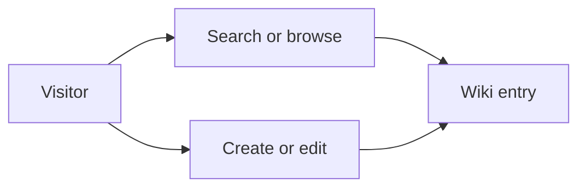

<div align="center"></div>

# Wiki | Django Encyclopedia Exercise

**Python · Django · Markdown-based content**

A learning application for creating, reading and editing encyclopedia-style entries. It is **not** a legal knowledge base or an authoritative source of legal information.

## Learning goals

- Search and navigate encyclopedia entries
- Create and update Markdown content
- Render entry pages and handle missing entries
- Explore server-side navigation with Django



## Local development

Set up a virtual environment, install the dependencies required by the project, and run:

```bash
python manage.py runserver
```

Review the project's Django version and development settings before deployment. The existing [video demonstration](https://youtu.be/j75pYUqBWgw) describes the original exercise.

[Developer profile](https://github.com/matef-hub) · *Historical coding exercise.*

## Database safety

The historical `db.sqlite3` file was removed from the tracked source tree. Create a fresh local database before development:

```bash
python manage.py migrate
```

Old database contents may remain in earlier public Git commits or clones. If the file ever contained actual accounts, secrets or personal information, investigate historical exposure and invalidate credentials; deleting it from the current tree does not purge history.
